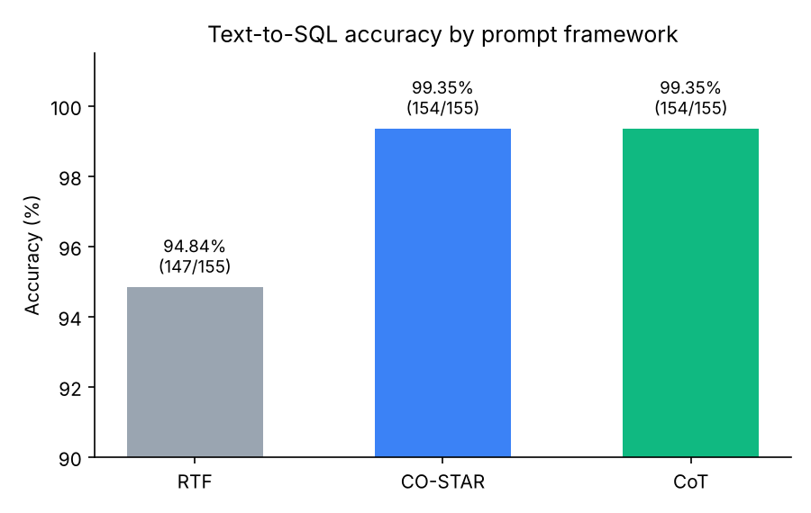

# Task 2 Report

## Setup
- **Model:** Claude Opus 5.5
- The model only got the files in `clean_run/inputs/` (the questions and the schema). The database, the correct answers and the checker script were kept out, so the model could not copy from them.
- Each prompt was run in a new session. Model, prompt, time and score of each run are in `runs.csv`.
- Predictions were scored with `data/evaluate_retrieval_predictions.py`: a query counts as correct if it returns exactly the same rows as the reference answer.

## Results
| Prompt | Correct | Accuracy | Inference time |
|---|---|---|---|
| RTF | 147 / 155 | 94.84 % | 1:08 |
| CO-STAR | 154 / 155 | 99.35 % | 1:19 |
| CoT | 154 / 155 | 99.35 % | 2:03 |

## Comparison
- **CO-STAR and CoT** got the same score (154/155). Both failed only on question 66 ("What is the lifes greates illusion?").
- **RTF** was the worst (147/155).
- **Conclusion:** more context in the prompt (CO-STAR) or step-by-step reasoning (CoT) clearly helped compared to the short RTF prompt.
- **Inference time:** CoT was the slowest (2:03) because it writes out its reasoning first. RTF (1:08) and CO-STAR (1:19) took almost the same time, so CO-STAR's extra context was more accurate at almost no extra cost.
