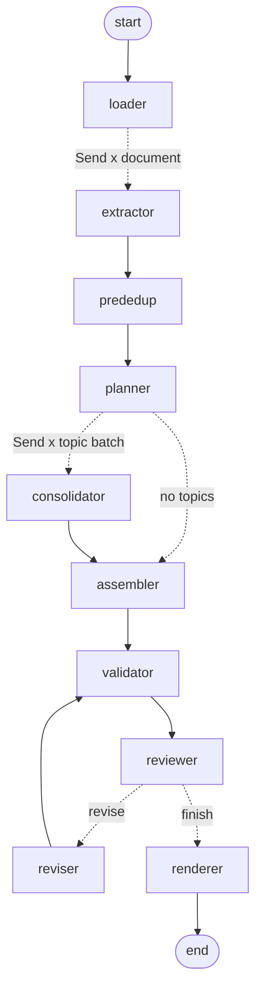

# Requirements Refinement Agentic Network: Design Report

**Task:** AI4SE Labs 2026, Week 04, Task 1. The network turns a corpus of mixed texts
about a software system into a single structured requirements document.

| Deliverable | Location |
|---|---|
| Python implementation (LangGraph) | `agentic_network/` (entry point `main.py`) |
| This report | `agentic_network/REPORT.md` |
| Generated requirements document | `agentic_network/out/requirements.md` (+ machine-readable `requirements.json`, graph diagram `graph.mmd`) |
| Development and run history | `agentic_network/RUN_LOG.md` |

**How to run:**

```powershell
cd agentic_network
powershell -ExecutionPolicy Bypass -File .\setup.ps1      # venv + dependencies, creates .env
# put OPENAI_API_KEY into .env
.\.venv\Scripts\python.exe main.py --input ..\data\corpus  # asks before any paid call
.\.venv\Scripts\python.exe main.py --input ..\data\corpus --mock   # free wiring test
```

The only required argument is the **input directory**. Every `.txt`, `.md` and `.eml` file below
it is read recursively; no file names are hard-coded.

---

## 1. Architecture



(Exported by LangGraph itself: `out/graph.mmd`. Dashed edges are conditional or fan-out edges.)

| # | Node | Kind | Model | Responsibility |
|---|---|---|---|---|
| 1 | **loader** | deterministic | – | Recursively reads the input directory; parses e-mails (sender, date, subject, whole thread); classifies document type (email, interview, minutes, survey, specification, reference); assigns IDs `D01…`; splits long texts into ~12k-char chunks with overlap |
| 2 | **extractor** | LLM, parallel (`Send`, one branch per document) | `gpt-5-mini` | Extracts *every* stated or implied requirement as a candidate: name, description, type, category, verbatim evidence quote, stakeholder priority hint |
| 3 | **prededup** | deterministic | – | TF-IDF cosine similarity groups textually near-duplicate candidates (hints for later steps) |
| 4 | **planner** | LLM + deterministic repair | `gpt-5.6-luna` | Sorts all candidates into ~20–25 topics so that duplicates and contradictions land side by side; writes a shared glossary. Code then repairs the plan (see §3.3) |
| 5 | **consolidator** | LLM, parallel (`Send`, one branch per topic batch) | `gpt-5.6-luna` | Per topic: merges semantic duplicates, resolves conflicts, rewrites in a uniform style, assigns priority, blacklists with a reason; must account for every candidate in its batch |
| 6 | **assembler** | deterministic | – | Joins the topic results; topic names become document sections; merges glossaries |
| 7 | **validator** | deterministic | – | Assigns final IDs, derives tracing, and checks completeness, duplicates, catch-alls, wording, and blacklist validity |
| 8 | **reviewer** | LLM | `gpt-6-luna` | Independent critic: finds duplicates, conflicts, lost needs, unjustified discards, weak descriptions, wrong priorities; rates each issue major or minor |
| 9 | **reviser** | LLM | `gpt-5.6-luna` | Fixes the reviewed issues in small, size-capped work packages (targeted revision, not a rewrite) |
| 10 | **renderer** | deterministic | – | Writes the final Markdown document and JSON |

The loop **validator → reviewer → reviser → validator** is the feedback loop. A deterministic
router ends it when the result is approved, when the maximum number of rounds (3) is reached, or
when nothing actionable is left.

---

## 2. Compliance with the specification

### 2.1 Network specs

| Spec | How it is met |
|---|---|
| **ANS1** ≥3 LLM nodes | 5: extractor, planner, consolidator, reviewer, reviser |
| **ANS2** ≥1 deterministic node | 5: loader, prededup, assembler, validator, renderer (plus the deterministic plan repair and router) |
| **ANS3** ≥1 feedback loop | reviewer checks the output of consolidator/reviser and loops back through the reviser and validator (max 3 rounds). There are also two inner self-check loops: completeness repair calls and JSON repair calls |
| **ANS4** ≥3 models | `gpt-5-mini` (extraction), `gpt-5.6-luna` (planning, consolidation, revision), `gpt-6-luna` (review) |
| **ANS5** LangGraph | `graph.py`: `StateGraph` with typed state and reducers, two `Send` fan-outs, conditional edges for the loop |

### 2.2 Output specs: which element addresses each one

| Spec | Prompt element | Deterministic element |
|---|---|---|
| **OS1** single structured document | – | renderer writes one `requirements.md` (sections: about, ID scheme and priority scale, glossary, sources, functional, non-functional/constraints, traceability, blacklist, open issues) |
| **OS2** unique IDs | – | validator assigns `FR-nnn`, `NFR-nnn`, `CON-nnn`, `BL-nnn`; documents get `Dnn`. The LLMs never produce IDs |
| **OS3** no duplicates | Consolidator task A (merge by meaning); Planner rule 1 (same need → same topic); Reviewer check 1 | prededup and co-location of near-duplicates in one topic; validator: candidate used by two requirements (blocking), textual similarity ≥ 0.6, catch-all (> 15 candidates, blocking) |
| **OS4** tracing | Extractor rule 7 (verbatim evidence quote) | the source document is attached by code at extraction; each requirement's sources are **derived** from its merged candidates, never taken from the LLM; the evidence quote is verified against the source text; traceability tables in both directions |
| **OS5** name + paragraph | Writing rules: name 3–8 words; description "The system shall…" with 3–6 sentences | validator flags descriptions < 30 words, wrong phrasing, long names |
| **OS6** priority + scale | Writing rules: MoSCoW scale with definitions; Extractor rule 8 collects priority hints | scale definitions are rendered in section 2 of the document |
| **OS7** consistency, no conflicts | Planner glossary (one preferred term per concept); Consolidator task C (resolve conflicts, prefer later and authoritative decisions); Reviewer checks 2–3 | assembler uses topic names as consistent sections; glossaries merged |
| **OS8** completeness | Extractor rule 1 ("missing one is worse than one too many"); Consolidator task B (account for every candidate) | plan repair assigns forgotten candidates; per-batch completeness check with repair call; validator blocks approval while any candidate is unaccounted; reviser packages pick up loose candidates; partially failed extractions are never cached |
| **OS9** blacklist | Consolidator task D (reasons conflict / nonsensical / out_of_scope, always explained); "fitting another topic is never a reason to discard" | blacklist section with reason, sources, conflicting requirement; validator blocks "out of scope" discards that do not explain why the item is not about the software |

---

## 3. Design choices and rationale

### 3.1 Extract per document, consolidate per topic

Extraction runs once per document (in parallel), so each call sees one coherent source and the
source of every candidate is known for certain. Consolidation must see candidates *from different
documents together*, so the planner regroups them by subject. Batches are limited to 8–60
candidates, a size the model can merge reliably (see §4: a single call over all 702
candidates lost 84% of them).

### 3.2 Model per role

- **Extraction:** cheap and high-volume (≈ 700 candidates) → `gpt-5-mini`.
- **Planning, consolidation, revision:** need judgement (meaning-level merging, conflict
  resolution, consistent rewriting) → the stronger `gpt-5.6-luna`.
- **Review:** deliberately a **different model** (`gpt-6-luna`) from the one that wrote the
  requirements, so the critic does not share the writer's blind spots.

### 3.3 Trust the LLM for judgement, code for bookkeeping

LLMs are good at meaning and bad at exact bookkeeping, so every count, ID and reference is
handled by code:

- **IDs and tracing** are assigned by code; LLM output schemas contain no ID or source fields
  that could be invented. Candidate IDs returned by the LLM are checked; unknown ones are dropped
  and reported.
- **Evidence verification**: each quote is checked against the source text (whitespace and
  quote-style insensitive). In the final run 683 of 714 quotes (96%) were verbatim.
- **Plan repair**: the planner's topic list is cleaned (unknown IDs, double assignments),
  forgotten candidates go to the topic of their most similar candidate, near-duplicates (cosine ≥
  0.55) are moved into one topic, topics < 8 are merged and topics > 60 are split. In the final
  run this fixed 269 double assignments and 6 forgotten candidates.
- **Completeness repair**: after each consolidation or revision call, code checks that every
  candidate of the batch is accounted for; if not, the model gets one follow-up call naming the
  missing IDs.

### 3.4 Structured output: JSON mode + Pydantic + one repair round

All LLM outputs are Pydantic models (`schemas.py`). The JSON schema is included in the prompt,
the API runs in JSON mode, and the answer is validated. On a validation error the error is sent
back once for repair. This works the same for reasoning and non-reasoning models; strict
schema mode rejects some schema features. Truncated answers are detected and reported instead of
being parsed.

### 3.5 The feedback loop

- **Reviewer input**: each requirement is shown together with the candidate statements merged
  into it, so the reviewer can see needs that got lost in a merge. Validator findings are also
  given.
- **Approval is decided by a fixed rule, not by the LLM's own flag:** approved ⇔ no *major*
  reviewer issue and no *blocking* validator finding (unaccounted candidate, invalid ID,
  candidate used twice, catch-all requirement, invalid discard). This makes the loop explainable
  and prevents "polite" approvals.
- **Targeted revision**: issues are grouped into work packages. Items named by one issue are
  revised together, loose candidates join their most similar requirement, and a package is
  capped at 60 candidates; issues that would exceed the cap are deferred to the next round. Major
  issues are packed first; minor (cosmetic) issues are only fixed where a package exists anyway.
  The reviser returns replacements for exactly the items of its package.
- **Termination**: approval, 3 rounds, or nothing actionable left. If revision fails, the
  previous result is kept.

### 3.6 Priority scale

MoSCoW (Must / Should / Could / Won't), with definitions in the document. Its four levels map
naturally to the wording found in the sources ("critical", "most requested", "nice to have",
"phase 2"), which the extractor collects as priority hints.

### 3.7 Blacklist semantics

Discards are reserved for statements that are **conflicting** (the better-supported side is kept,
preferring later and more authoritative decisions), **nonsensical** (unmeasurable, impossible,
self-contradictory) or **out of scope** (not about the software: project tasks, meetings,
documentation conventions). Run 2 showed the model also discarding valid needs "because they
belong to another topic". This is now forbidden in the prompts and caught by a validator check.

### 3.8 Generality, cost control and testability

- Input directory is a parameter; file types are configurable; the number of topics scales with
  the number of candidates; all thresholds are settings in `config.py` / `.env`.
- **Confirmation prompt** shows planned calls and models before any paid call.
- **Extraction cache** keyed by model, prompt, schema and document text; partial results are never
  cached. Changing later stages does not re-pay extraction.
- **Mock mode** (`--mock`) runs the full graph with a deliberately imperfect fake LLM (forgets
  candidates, invents IDs, over-merges) to exercise every safety net for free, using real cached
  candidates.
- Token usage per model is reported at the end of each run and in the document.

---

## 4. Development history (iterations)

Full details, including token counts and costs, are in `RUN_LOG.md`.

| | Run 1 | Run 2 | Run 3 (final) |
|---|---|---|---|
| Design | one Consolidator call for all candidates; full rewrite per round | planner + per-topic consolidation + targeted revision | + extractor limit fix, + discard-rule fix |
| Candidates | 702 | 609 (SRS part 2/3 lost) | **714** |
| Accounted for | 109 (16%) | 609 (100%) | **714 (100%)** |
| Requirements | 12 (catch-alls) | 260 | **308** |
| Blacklisted | 3 | 40 (24 invalid) | **13 (all valid)** |
| Largest merge | 23 candidates | 11 | **10** |
| Cost | ≈ $0.38 | ≈ $0.49 | ≈ $0.25 |

**Lessons:**
1. A single LLM call cannot reliably merge hundreds of items; it silently drops them while
   producing plausible-looking output. Fixed by **batching** plus **code-enforced completeness**.
2. Output limits include reasoning tokens; dense specification text exceeded 16k tokens.
   Fixed by a higher limit and by **never caching partial results**.
3. A prompt sentence meant as context ("other topics are handled separately") was read as
   permission to discard. Fixed by an explicit rule **and a deterministic check**, because prompt
   wording alone is not a guarantee.

Before each paid run, the design was verified with free offline tests and the mock mode. That
found three further bugs before they could cost tokens: a crash on single-item issues, revision
packages without a size cap, and a planner fallback that would have produced 100+ calls.

---

## 5. Results of the final run

- **20 documents → 714 candidates → 308 requirements** (250 functional, 26 non-functional,
  32 constraints) in **22 topic sections**, plus **13 blacklisted** statements.
- Every candidate is accounted for exactly once; all 20 documents are traced; 147 requirements
  combine statements from several documents.
- All 308 descriptions start with "The system shall" (mean 51 words); glossary of 20 terms.
- Priorities: Must 145, Should 141, Could 21, Won't 1.
- Blacklist: 8 out of scope (project tasks, meetings, documentation scope), 3 resolved conflicts
  (e.g. a statement that configuration migration is unavailable vs. the later subcommittee
  requirement to provide it), 2 nonsensical.
- Review: 3 rounds, ending with 5 major and 3 minor open issues and **no structural (validator)
  issues**. The open issues are listed in section 9 of the document.

**Note on the token table in the final document:** in the final run, 19 of 20 documents were
taken from the extraction cache produced by the same `gpt-5-mini` extractor in run 2. Only the SRS
was re-extracted, so the table shows 3 `gpt-5-mini` calls. In run 2 (clean slate, no cache) all
three models were used in one run with 23 extraction calls.

---

## 6. Limitations and possible improvements

- **Not approved by the reviewer.** The last round still reports 5 major issues: a duplicate,
  three partially covered details, and an architecture tension (reporting on the primary
  database vs. a replica or warehouse) that is also present in the sources. With ~300 requirements,
  each round tends to surface new fine-grained findings. More rounds or a human decision on the
  architecture question would be needed.
- **Non-determinism.** Extraction counts vary between runs (e.g. 702 vs. 609 vs. 714 candidates),
  and so do the topic plans. The cache makes runs repeatable where needed.
- **Lexical similarity.** Pre-dedup and duplicate checks use TF-IDF, not semantic embeddings;
  meaning-level duplicates are left to the LLMs (consolidator and reviewer).
- **Priority skew.** Must and Should dominate. The stakeholders rarely state low priority,
  and the model tends towards Must for core reporting needs.
- **Corpus-specific prompt examples** (e.g. library terms in the planner's topic examples) are
  illustrations only; nothing in the code depends on this corpus. A different corpus might
  benefit from different examples.
- **Cost and time:** about 12–13 minutes and $0.25–0.50 per run at current list prices.

---

## 7. Use of a coding agent

As required, the network was developed with a coding agent (Claude). The agent proposed the
architecture, wrote and tested the code (offline tests, a mock LLM, a stand-in for LangGraph
semantics), analysed every run's output against OS1–OS9, and proposed the fixes recorded in
`RUN_LOG.md`. Paid runs were only started after explicit confirmation.

---

## 8. File overview

| File | Purpose |
|---|---|
| `main.py` | CLI: preview, confirmation, run, usage report |
| `graph.py` | LangGraph wiring (nodes, `Send` fan-outs, loop router) |
| `state.py` | Typed graph state with reducers; `Send` payload types |
| `schemas.py` | Pydantic models for all LLM outputs and internal records; priority scale |
| `prompts.py` | Prompts of all LLM roles, with `[OSn]` annotations |
| `nodes/llm.py` | extractor, planner, consolidator, reviewer, reviser; work packaging |
| `nodes/deterministic.py` | loader, prededup, plan repair, assembler, validator, renderer |
| `llm_client.py` | OpenAI calls in JSON mode, validation, repair, token accounting |
| `similarity.py` | TF-IDF cosine similarity, clustering, nearest neighbours |
| `config.py` | Models, thresholds, limits (overridable via `.env`) |
| `mock_llm.py` | Fake LLM for free end-to-end tests (`--mock`) |
| `offline_check.py`, `try_extractor.py`, `check_setup.py` | Offline test of deterministic nodes; single-document extractor test; environment check |
| `RUN_LOG.md` | Every paid run, its problems and the resulting changes |
