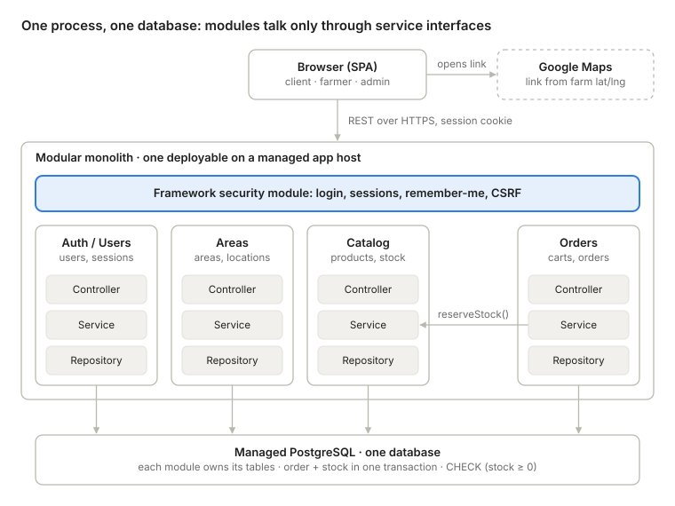

# ADR-001: Architecture for Not Far(m) From Home

29 October 2026 · NFFH student team

**TL;DR:** We choose Architecture A, a layered modular monolith on managed PostgreSQL, using the framework's security module for login. It gives one transaction for order plus stock, fails closed when we make security mistakes, and fits 3 people, 3 months and a low budget. C (serverless/BaaS) is the runner-up; B (microservices) is rejected as overkill.

## Status

Proposed, pending team review. We adopt Architecture A, a layered modular monolith on managed PostgreSQL with the framework's built-in security module.

- **Deciders:** NFFH student team (3 members)
- **Format:** Nygard-style ADR, extended with decision drivers and considered options (MADR)
- **Supersedes:** none. **Superseded by:** none.
- **Source material:** NFFH.txt (system description, 41 user stories) and notes.txt (architecture exploration, sections 0 to 10)

## Context

NFFH is a "km 0" web platform where local farmers post produce and clients reserve it for pickup at the farm on a chosen day. There is no delivery and no online payment, so an order is a reservation plus a pickup date.

**Roles and capabilities.** The 41 user stories cover three roles: Client, Agricultural Company (farmer) and Administrator. They group into:

- Authentication and session: register, login, "remember me", logout, view own profile (stories 1-5, 17-24)
- Catalog and inventory: farmer and admin product CRUD, hot/seasonal products (6, 8, 14-16, 33-38)
- Geography: admin-managed areas, farms by area, farm location opened in Google Maps (7, 13, 30-32, 35, 39)
- Cart and orders: cart management, complete order with pickup date, order lists per role (9-12, 26, 40, 41)
- User administration: list, view, modify, delete malicious users (25, 27-29)

**Scope and constraints.** The platform serves a small region: a few hundred clients and dozens of farms. It is built by a student team of 3 in about 3 months, on a low hosting budget, as a web application only. The course is Software Engineering using AI, so the design must be visible, explainable and testable.

**Technical forces.**

- Completing an order must reserve stock atomically; two clients must not both buy the last unit.
- Authorisation depends on ownership, not only role: a farmer edits only their own products and a client sees only their own orders.
- Deleting a user, area or product must not break existing orders or farms.
- "Remember me" requires long-lived sessions that can still be revoked when an admin deletes a malicious user.
- The team has limited experience with any of the candidate architectures, so the cost of mistakes matters more than ideal-case quality.

## Decision drivers

Listed in priority order for our scope.

1. **Deliverability:** all 41 stories working within ~3 months with 3 people.
2. **Security under inexperience:** mistakes should fail closed (a missing feature or a 403), not open (exposed data).
3. **Data consistency:** order creation and stock decrement in one ACID transaction, with no overselling.
4. **Low cost and low operations load:** cheap hosting, no dedicated "ops person".
5. **Visible, testable design:** module boundaries, layers and business rules that can be shown, reviewed and tested for the course.
6. **Evolvability:** a path to split the system later if the platform grows, without vendor lock-in.

## Considered options

### Option A: Layered modular monolith

One deployable backend and one PostgreSQL database, exposing a REST API to an SPA or server-rendered frontend. The code is cut vertically into modules (auth/users, catalog, areas, orders), each owning its tables, and horizontally into controller, service and repository layers. Modules call each other only through service interfaces.

- Good: one ACID transaction; simple to build, test and deploy; closed by default.
- Bad: scales and fails as one unit; module boundaries kept only by discipline.

### Option B: Microservices with API gateway

Four services (Identity, Catalog/Inventory, Orders, Geo/Areas), each with its own database, behind a gateway that validates JWTs. Services communicate by REST and asynchronous events through a broker; checkout becomes a saga (OrderPlaced, then StockReserved or StockRejected).

- Good: independent scaling and deploys; fault isolation.
- Bad: sagas and eventual consistency; many components to build and run.

### Option C: Serverless / Backend-as-a-Service (e.g. Supabase)

Managed authentication and hosted PostgreSQL, with most reads and writes going from the browser straight to the database under row-level security (RLS). Trusted logic (complete order, delete or modify user) runs in edge or database functions.

- Good: least code; authentication nearly free; free tiers.
- Bad: open by default, so a forgotten rule leaks data; vendor lock-in.

### Options against the decision drivers

A is the only option with no weak rating on our top three drivers. C wins on deliverability but is weak on security for an inexperienced team; B is weak on four of six drivers.

| Decision driver | A: Modular monolith | B: Microservices | C: Serverless / BaaS |
| --- | --- | --- | --- |
| 1. Deliverability (41 stories, 3 people, ~3 months) | Good: one codebase, auth via framework module | Weak: sagas, outbox, broker and 4 services eat the schedule | Strong: auth and CRUD nearly free |
| 2. Security under inexperience | Strong: fails closed; attack surface = our endpoints | Weak: A's risks plus service-to-service auth, JWT revocation, more secrets | Weak: fails open; every table, column, view, function, bucket must be secured |
| 3. Data consistency (order + stock) | Strong: one ACID transaction | Weak: saga, eventual consistency, PENDING orders | Good: Postgres transaction, but only inside functions |
| 4. Cost and operations load | Good: 1 app host + 1 managed DB | Weak: ~4 services, 4 DBs, broker, gateway, tracing | Strong: free tiers, no servers (inactive projects may pause) |
| 5. Visible, testable design | Strong: modules, layers, rules in code with familiar tests | Good: boundaries physical, but needs contract and distributed tests | Weak: logic spread over RLS, triggers, functions, frontend |
| 6. Evolvability / lock-in | Strong: no lock-in; splits into B along modules | Strong: already split | Weak: vendor-specific APIs and policies |
| **Verdict** | **Chosen** | **Rejected** | **Runner-up** |

## Decision

We will build NFFH as a layered modular monolith (Option A), and rent the commodity parts: a managed PostgreSQL database, a managed app host, and the framework's established security module for authentication. Option C is the documented runner-up; Option B is rejected.

*Chosen architecture · 4 modules, 3 layers, 1 database*

Every request passes the framework security module, then one module's controller, service and repository. Orders reserves stock only by calling Catalog's service, and both writes land in the same database transaction.

Binding rules that come with this decision:

1. **Modules:** auth/users, catalog, areas, orders. Each owns its tables; cross-module access goes only through service interfaces (for example orders calls `catalog.reserveStock()`, never queries the products table). Boundaries are enforced by an architecture test or import lint rule.
2. **Layers:** controller (HTTP, input validation, DTOs) to service (business rules, transactions, authorisation) to repository (SQL).
3. **Authentication:** the framework's security module (for example Spring Security, Django auth or NestJS guards with Passport). No hand-rolled password hashing, token generation or session handling. Passwords use bcrypt or argon2.
4. **Sessions:** server-side sessions in an HttpOnly, Secure, SameSite cookie, with a hashed, rotating remember-me token and CSRF protection. Deleting a user invalidates their sessions immediately.
5. **Authorisation:** checked in the service layer on every operation, covering both role and ownership. Admin stories reuse the same service methods under an admin policy.
6. **Stock reservation:** completing an order runs in one transaction, with one conditional update per item (`UPDATE products SET stock = stock - :q WHERE id = :id AND stock >= :q`). Zero rows affected rolls back the whole order and returns 409. A `CHECK (stock >= 0)` constraint is the safety net.
7. **Data rules:** money as NUMERIC/BigDecimal with a stored unit; unit price snapshotted into order items; pickup date stored as DATE; soft delete plus FK RESTRICT instead of cascading deletes.
8. **Maps:** farms store latitude and longitude; the UI links to a Google Maps search URL, so no API key is needed.

## Rationale

A is the option that best fits our constraints, not the best architecture in general.

**Why not B.** Its benefits (independent scaling, team autonomy) have no value at a few hundred users and one team of 3. Its costs land directly on our constraints: sagas, outbox, idempotency and tracing consume the 3-month budget, and four services, four databases, a broker and a gateway do not fit a low hosting budget. B adds distributed problems without removing local ones.

**Why A over C.**

- Consistency: A keeps the order and stock update in one transaction with all rules in code (C matches this only inside functions).
- Security for an inexperienced team: given limited experience, we consider A the lower-risk option. Its failure mode is closed: a missing authorisation rule results in a denied or missing feature rather than exposed data. Its attack surface is limited to endpoints we explicitly implement, and its authorisation logic is code that can be reviewed and tested with familiar techniques. This holds on the condition that authentication uses the framework's established security module. C provides stronger authentication out of the box, but its open-by-default data access means configuration omissions lead directly to data exposure.
- Course fit: A makes the design visible (modules, layers, interfaces, transactions), while in C much of it disappears into configuration and policies.
- Cost and lock-in: one small app host and one managed Postgres instance stay cheap, with no dependency on a single vendor's APIs.
- Evolvability: a clean modular monolith can later be split along its module boundaries into the services of B.

**What C does better, and why we accept the loss.** C would give us authentication for free, no server to run, and a lower risk of not finishing on time. We close most of that gap by renting the boring parts: the framework's auth module replaces hand-written authentication, and a managed host and database remove most server operations.

## Consequences

### Positive

- Checkout is a single transaction: no sagas, no PENDING state, immediate 201 or 409 for the user.
- One codebase, one stack trace and one deploy artifact make development, debugging and integration testing simple.
- Authorisation lives in one service layer that the team can review in pull requests.
- Hosting stays within a low budget: one small app instance and one managed Postgres.
- Scheduled work, such as releasing stock after no-shows, is a simple in-process job.

### Negative

- The whole application scales and deploys as one unit, and a crash or memory leak affects every feature.
- We write more backend code than in C, including CRUD endpoints for all three roles.
- Module boundaries can erode into a "big ball of mud" unless enforced by tests and review.
- We own server-side concerns that C would handle: secrets, TLS configuration and dependency updates (reduced by the managed host).

### Risks and mitigations

- **Overselling under concurrency.** Mitigated by the conditional update and CHECK constraint; verified by an integration test firing parallel checkouts against a real database.
- **IDOR (missing ownership check).** Mitigated by a single policy check per service method; tests per role attempt to access another user's products and orders.
- **Mass assignment** (for example a request body setting role to admin). Mitigated by explicit request DTOs that never bind role, owner or status fields.
- **Authentication mistakes.** Mitigated by using only the framework security module; login rate limiting and secure reset tokens come from the library, not custom code.
- **Schedule overrun.** The rule-heavy core (orders, stock, authorisation) is built first; admin CRUD stories, which are mostly repetitive, come last.

## Conditions to revisit

This decision should be reopened if any of the following becomes true.

- **Switch to C** if no team member is comfortable with a backend framework, if the grading puts a polished, feature-complete app above visible design and testing, or if the team is frontend-heavy and comfortable writing and testing RLS policies.
- **Move toward B** only if the platform outgrows one region and several teams work on it, or if one module (likely Catalog) needs independent scaling. The split would follow the existing module boundaries.
- **Revisit the security claim** if authentication cannot be delegated to a framework module; without that condition, the argument that A is lower-risk no longer holds.

## Open issues and follow-up decisions

These do not change the choice of A, but each needs its own decision before or during implementation.

- [ ] **Backend framework and stack** (Spring Boot, Django or NestJS), chosen by team experience. Required: the security rationale depends on its auth module.
- [ ] **Hosting:** which managed app host and managed PostgreSQL provider, in an EU region for GDPR.
- [ ] **Multi-farm cart:** split into one order per farm, each with its own pickup date (proposed), to be confirmed before the data model is fixed.
- [ ] **Order semantics and no-shows:** stock is reserved when the order is completed (proposed); how long is it held before release?
- [ ] **Farm opening hours:** needed to validate pickup dates but missing from the user stories.
- [ ] **"Hot products" definition:** seasonal tag set by the farmer, most ordered, or admin-curated.
- [ ] **"Farms in my area":** admin-defined areas (as in stories 30, 35, 39) or distance from the client's location.
- [ ] **Address geocoding:** how farm latitude and longitude are captured at registration.
