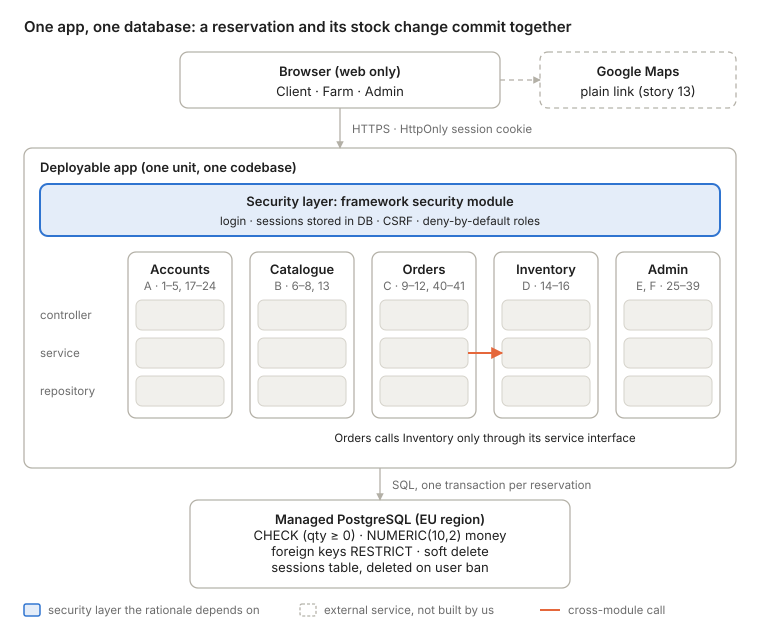

# ADR-001: Architecture for Not Far(m) From Home

29 October 2026 · Deciders: student team of 3 · Drafted by Erik

## TL;DR

We will build NFFH as a **layered modular monolith (Option A)** on a managed PostgreSQL database. It wins because one database transaction keeps stock correct when a reservation is completed, one codebase and one deploy fit 3 students in 3 months, and authorisation lives in ordinary server code we can review and test. The runner-up is **serverless / BaaS (Option C)**, which is faster to start and cheaper to run. **Microservices (Option B)** are rejected: unneeded complexity.

## Status

- **Status:** Proposed, pending team review. Build NFFH as a layered modular monolith (Option A).
- **Deciders:** the student team of 3.
- **Format:** Nygard-style ADR, extended with MADR decision drivers and considered options.
- **Supersedes / Superseded by:** none.
- **Source material:** NFFH.txt (system description and 41 user stories), notes.txt (exploration notes, exchange #1). The per-option deep dives, comparison table and scope choice were not run before this draft; ratings below come from the first impressions in the notes and are flagged for review.

## Context

Not Far(m) From Home is a "km 0" marketplace: farms list fresh produce, and clients reserve it and pick it up at the farm on a chosen day. There is no payment and no delivery, so an "order" is a reservation plus a pickup date. Areas are regions managed by the administrator, and the only external integration is a Google Maps link.

**Roles and capability groups.** Three roles: Client, Agricultural Company (farm), Administrator.

| Group | Stories |
| --- | --- |
| A. Accounts & sessions | 1–5 (client), 17–21 (farm), 22–24 (admin) |
| B. Discovery & catalogue | 6, 7, 8, 13 |
| C. Cart & orders | 9–12, 40, 41 |
| D. Farm inventory | 14–16 |
| E. Admin: users & companies | 25, 27–29, 31, 32 |
| F. Admin: catalogue, areas, reporting | 26, 30, 33–39 |

**Scope and constraints.** Small user base; a student team of 3; about 3 months; low hosting budget; web only. Team stack experience and what the work is graded on are not yet known.

**Technical forces** (the requirements that separate the options):

- **Stock consistency:** completing a reservation (12) must check and decrement stock atomically, across several products and possibly several farms.
- **Ownership-based authorisation:** a farm may only change its own products (14–16) and see its own orders (41); a client only their own cart and orders (9–12, 40). Role checks alone are not enough.
- **Revocable sessions:** users stay logged in across reloads (3, 19, 23), yet a user deleted by the admin (25) must lose access at once.
- **Safe deletes:** products, users and areas (15, 25, 38, 39) can be referenced by existing orders.
- **Admin reporting:** cross-cutting queries over all orders, users and farms by area (26, 27, 31).
- **Team capacity:** 3 people must deliver all 41 stories, with time for testing.

## Decision drivers

In priority order for this scope:

1. **Deliverability:** can 3 students ship all 41 stories, tested, in about 3 months?
2. **Data consistency:** can a reservation never oversell stock, even with two clients checking out the last unit at once?
3. **Security under inexperience:** when we forget a check, does the system fail closed (deny) rather than expose data?
4. **Cost and operations load:** does it run on a low budget with almost no time spent operating it?
5. **Visible and testable design:** can we show the structure in a report and test the key flows end to end?
6. **Evolvability and lock-in:** can it grow or be split later without a rewrite or a vendor migration?

## Considered options

**Option A: Layered modular monolith.** One deployable app and one relational database. The code is split into modules that follow the capability groups, each with controller → service → repository layers.

- Good: one transaction for order + stock; one codebase and deploy; structure maps directly to the stories.
- Bad: we write and host a server; scales only as one unit; more hand-written CRUD than C.

**Option B: Microservices behind an API gateway.** Identity, Catalogue/Inventory, Orders and Reporting run as separate services, each with its own database. A gateway checks tokens and routes requests.

- Good: independent deploy and scaling; boundaries enforced by the network; looks impressive in a report.
- Bad: the order flow crosses services, so stock needs distributed consistency; several deployables to run and pay for; auth repeated per service.

**Option C: Serverless / BaaS (e.g. Supabase or Firebase).** A browser app talks to managed auth and a managed database. Authorisation is written as row-level security rules, with a few functions for custom logic such as completing an order.

- Good: fastest to a working demo; near-free hosting; no server to operate.
- Bad: security lives in rules that are easy to get subtly wrong; logic spread over rules, config and functions; vendor lock-in.

### Options against the decision drivers

Option A is the only option with no Weak rating on any driver; C beats it on speed and cost but is weak on the security and design drivers.

| Driver | A. Modular monolith | B. Microservices | C. Serverless / BaaS |
| --- | --- | --- | --- |
| **1. Deliverability** | Strong: one codebase, one deploy | Weak: 4 services, gateway, contracts | Strong: managed auth and DB |
| **2. Data consistency** | Strong: one DB transaction | Weak: order spans services | Good: one DB, but needs a function |
| **3. Security under inexperience** | Good: checks in one server layer, deny by default | Weak: auth in gateway and every service | Weak: browser reaches DB; a wrong rule exposes data |
| **4. Cost and operations** | Good: one app + managed DB | Weak: many deployables | Strong: free tier, nothing to run |
| **5. Visible and testable design** | Strong: modules and layers visible; integration tests | Good: clear boundaries, hard to test end to end | Weak: logic split across rules and functions |
| **6. Evolvability and lock-in** | Good: modules can be split later | Strong: already split | Weak: vendor lock-in |
| **Verdict** | **Chosen** | **Rejected** | **Runner-up** |

## Decision

We will build NFFH as a layered modular monolith (Option A), and rent the commodity parts (a managed PostgreSQL database, a low-cost app host in an EU region, and the framework's own security module). Option C is the documented runner-up; Option B is rejected.

*NFFH component and layer view · 5 modules, 1 database (tentative)*

Every request passes the security layer first; the one cross-module call, Orders to Inventory, goes through a service interface so the stock change stays in the same transaction.

### Binding rules that come with this decision

1. **Modules and boundaries.** The app has five modules: Accounts (group A), Catalogue (B), Orders (C), Inventory (D) and Admin (E, F). A module calls another only through its public service interface, never its repository or tables. An architecture test in CI fails the build on a forbidden import.
2. **Layers.** Controllers handle HTTP and input shape only. Services hold business rules, authorisation and transaction boundaries. Repositories hold SQL only.
3. **Authentication.** Login, password hashing and session handling use the framework's security module. No hand-rolled crypto or tokens. The admin account is seeded, with no public admin registration.
4. **Sessions and revocation.** "Stay logged in" (3, 19, 23) is a server-side session in the database, sent as an HttpOnly, Secure, SameSite=Lax cookie. Deleting or banning a user (25) deletes their sessions. State-changing requests carry CSRF protection.
5. **Authorisation.** Deny by default: every endpoint declares its role. Every service method on owned data also checks ownership by scoping its query to the caller, e.g. `WHERE seller_id = :currentFarm`. A farm editing another farm's product gets 404.
6. **Consistency.** Completing a reservation (12) runs in one transaction. Each line decrements stock with a conditional update: `UPDATE product SET qty = qty - :n WHERE id = :id AND qty >= :n`. Zero rows updated means rollback and 409. A `CHECK (qty >= 0)` constraint is the safety net.
7. **Data rules.** Money is `NUMERIC(10,2)` with a unit on each product (per kg, per piece). Order lines copy name, price and unit at order time (16). Pickup day is a `DATE`; event times are `timestamptz` in UTC. Users, products and areas referenced by orders are soft-deleted (`deleted_at`), with foreign keys set to RESTRICT.
8. **External integrations.** The Google Maps link (13) is a plain URL built from the farm's stored address; no API key or Maps SDK.

## Rationale

Option A best fits our constraints, not the best architecture in general.

**Why not Option B.** Its benefits are independent deployment, independent scaling and team autonomy. With a small user base and one team of 3, none of them has value. Its costs land squarely on our constraints: the key request (12) crosses the Orders and Inventory services, so keeping stock correct needs a saga or distributed transaction; several deployables cost hosting money and operations time; and authentication must be repeated in the gateway and every service.

**Why Option A over Option C.**

- **Deliverability:** a tie at the start; C reaches a demo faster, but A has no second paradigm (rules plus functions) to learn, and the admin CRUD (26–39) is routine in a web framework.
- **Data consistency:** both use one database, but in A every write goes through server code, so the conditional decrement in a transaction is the normal path. In C, completing an order needs a server function anyway, while other writes go straight from the browser.
- **Security under inexperience:** A is lower-risk for our team, because authorisation is ordinary server code in one layer that we review in pull requests and cover with integration tests, and the framework denies unlisted endpoints. This holds on the condition that we configure deny-by-default and test ownership on every endpoint. C's row-level security is genuinely strong once correct, since it is enforced even when app code is buggy; but a missing or mistaken policy exposes data directly to the browser, and such policies are harder to review and test.
- **Visible and testable design:** A's modules and layers map onto the capability groups, which is easy to show in a report and to cover with integration tests against a real database.
- **Evolvability and lock-in:** A runs on any host with PostgreSQL; C ties data, auth and rules to one vendor.

**What Option C does better, and why we accept the loss.** C is faster to start and cheaper to run, with no server to operate. We close most of that gap with the middle path: rent the boring parts (managed PostgreSQL, a low-cost host, the framework's security module) and write only the business logic ourselves.

## Consequences

**Positive**

- Order completion and stock update are one transaction, with a database constraint behind them.
- One codebase, one deploy and one local setup for all three of us.
- Each module maps to a capability group, so stories, code and report line up.

**Negative**

- We write and host a server, which means some operations work and a host to pay for or keep within a free tier.
- More hand-written CRUD than C, especially the admin stories 26–39.
- The app scales only as one unit (acceptable for a small user base).

**Risks and mitigations**

- Two clients oversell the last unit: conditional decrement plus `CHECK (qty >= 0)`; verified by an integration test running two concurrent checkouts on a product with qty 1.
- A missing ownership check exposes another farm's data: deny-by-default plus owner-scoped queries; verified by a test per endpoint where farm X touches farm Y's product and gets 404.
- A deleted user keeps a live session: sessions stored in the DB and removed on delete; verified by a test where the admin deletes a user and that user's next request gets 401.
- Module boundaries erode over 3 months: architecture test in CI; verified by the build failing on a forbidden import.
- Deleting a product or area breaks order history: soft delete plus RESTRICT foreign keys; verified by a test deleting a product that has orders.
- Free-tier host sleeps or hits limits during the demo: choose and deploy to the host in week 1; verified by a smoke test against the deployed app.
- Schedule slip: build the rule-heavy core first (accounts and sessions, inventory, reservation completion), and the repetitive admin CRUD (26–39) last.

## Conditions to revisit

- **Switch to Option C** if we fall behind schedule and the team is confident writing and testing row-level security policies, or if no affordable host for a server app is available.
- **Move toward Option B** only if separate teams come to own parts of the system, or one part (likely Catalogue browsing, 6–8) needs to scale on its own. The split would follow the existing modules, each taking its own tables.
- **Revisit the security claim** if we cannot keep deny-by-default configuration and per-endpoint ownership tests in place; without them, A loses its advantage over C.

## Open issues and follow-up decisions

These do not change the choice, but each needs its own decision. Items marked REQUIRED must be settled for the rationale to hold.

- [ ] **REQUIRED: backend framework and stack** (OI-16). It makes the authentication and session rules concrete and confirms the team-experience assumption.
- [ ] **REQUIRED: stock semantics** (OI-2). When stock is decremented and what restores it (cancel, no-show); binding rule 6 assumes "at completion".
- [ ] **REQUIRED: session strategy confirmed** (OI-5). Binding rule 4 picks server-side sessions; confirm before building group A.
- [ ] **REQUIRED: delete policy** (OI-6). Soft delete for referenced data, and what happens to open orders.
- [ ] Multi-farm cart: one order per farm, each with its own pickup date? (OI-1)
- [ ] Order lifecycle states and who can change them (OI-3).
- [ ] Pickup date rules: opening days, lead time, daily capacity (OI-4).
- [ ] Price snapshot fields on order lines (OI-7).
- [ ] Definition of "hot products" (OI-8).
- [ ] "In my area": area chosen by client or by geolocation; farm address data (OI-9).
- [ ] Units, decimal quantities and currency (OI-10).
- [ ] Farm onboarding: self-registration or admin approval (OI-11).
- [ ] Audit log for admin edits; seeding the admin account (OI-12).
- [ ] Editing and deleting personal information under GDPR (OI-13).
- [ ] Confirm payments, delivery and notifications are out of scope (OI-14).
- [ ] EU hosting region for data location (OI-15).
