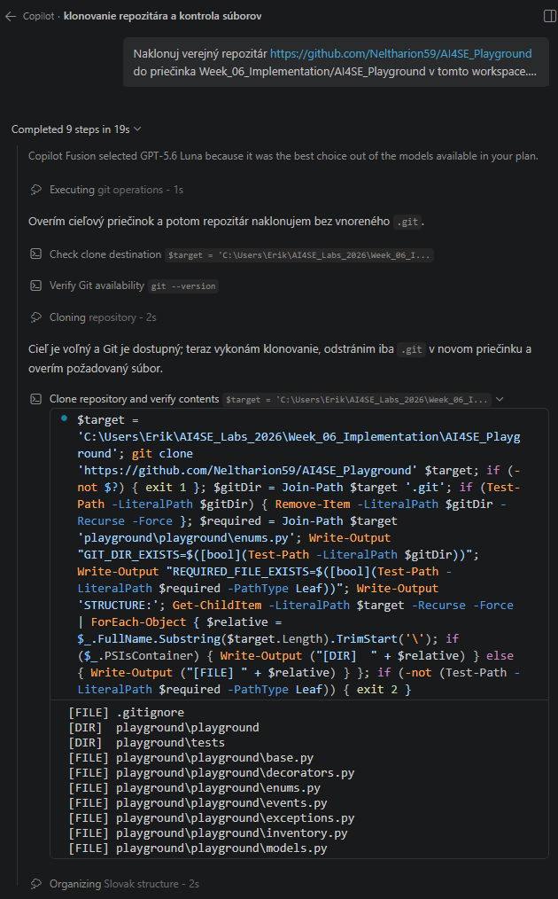
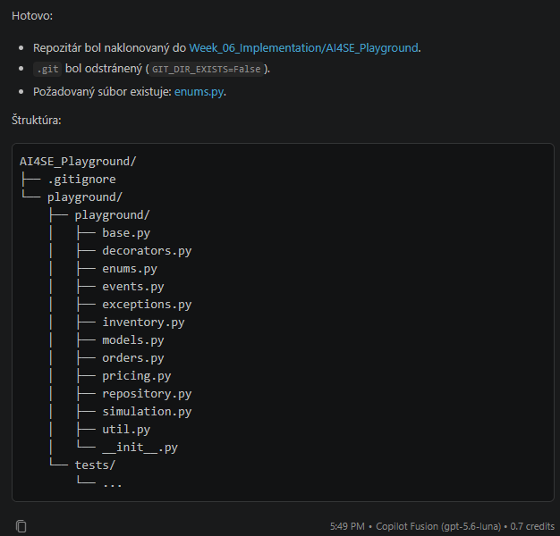

# Repository Cloning Report

## Overview

The public repository `https://github.com/Neltharion59/AI4SE_Playground` was cloned into:

`Week_06_Implementation/AI4SE_Playground`

The repository's `.git` directory was then removed so that the cloned project would not become a nested Git repository.

## Tools and Commands

I used GitHub Copilot Chat in Agent mode in VS Code. Copilot Fusion automatically selected the model GPT-5.6 Luna, which used tool calling to run PowerShell commands in the workspace terminal. The main commands were:

```powershell
git clone "https://github.com/Neltharion59/AI4SE_Playground" `
  "C:\Users\Erik\AI4SE_Labs_2026\Week_06_Implementation\AI4SE_Playground"

Remove-Item `
  -LiteralPath "C:\Users\Erik\AI4SE_Labs_2026\Week_06_Implementation\AI4SE_Playground\.git" `
  -Recurse -Force
```

I also used PowerShell checks to list the resulting directory structure and to verify that `playground/playground/enums.py` exists.

## Mechanism and Confirmation

The operation was enabled by tool calling: the assistant invoked the workspace PowerShell terminal rather than manually operating a graphical Git client. The user's request served as authorization for the clone and cleanup, so no additional confirmation prompt was required.

## Screenshots

Agent steps (tool calls executed in the VS Code terminal):



Result:

