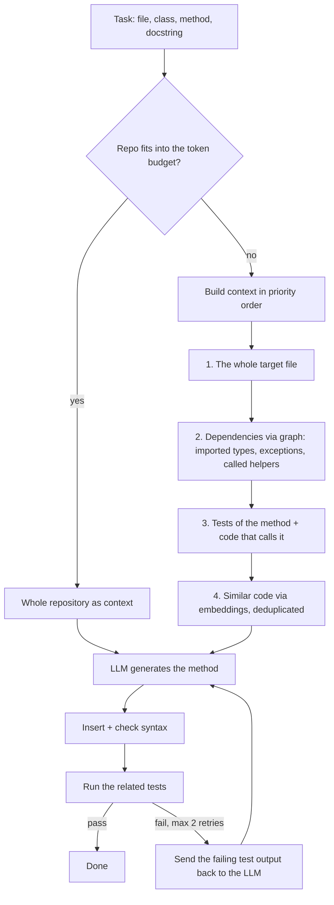

# Task 6 (Bonus) – Ideal pipeline for repository-aware code generation

This report uses the results of Tasks 2–5 as evidence.

## What we learned in Tasks 2–5

- The RAG pipeline (AST chunks → embeddings → top-5 → `gpt-5-mini`) reduced failing tests from **52 to 18**.
- **13 of the 18 failures** were caused by **missing dependencies** in the context. Retrieval found similar methods, but not the `Money` class (`BulkDiscountPricing.price`) or the `InvalidTransitionError` exception (`OrderStateMachine.transition`).
- **5 failures** were caused by **edge cases that are only defined in the tests**, not in the docstring (`InventoryLedger.__contains__`, `EventBus.__contains__`, `OrderLog.by_status`).
- The whole repository is only **~81k tokens**. It would fit into the context window of current models.

## Answers to the questions

### Is embedding matching the best strategy?

**No, not on its own.** Embedding similarity finds code that *looks like* the task: sibling methods of the same class. Code generation, however, needs the code the method *depends on* (types, exceptions, helpers it calls) and the code that *defines its behaviour* (tests). These do not look similar to the task text, so they rank low. This is exactly what happened in Task 5.

A better approach combines several kinds of retrieval:
- **Structural (dependency graph):** follow imports, type hints, the class hierarchy and calls. `orders.py` imports `InvalidTransitionError`; `price` returns `Money`. This retrieval is exact and costs nothing (static analysis with `ast`).
- **By name:** tests whose name contains the method (`test_*can_afford*`) and code that calls the method (`Order.advance` calls `transition`).
- **Embeddings:** still useful for finding *similar patterns* (e.g. `OrderBuilder.__len__` for `Order.__len__`) and for large repos where you don't know where to look.

### Would a different number of chunks work better?

**A fixed number is the wrong unit; a token budget is better.** Top-5 was sometimes too little (the dependency was missing) and sometimes contained near-duplicates (5 other `Money` methods for `Money.__bool__`).

- **Small repository** (like this one, ~81k tokens): put the whole repo into the prompt, no retrieval needed. Nothing can be "not found".
- **Large repository:** fill a budget (e.g. 20–30k tokens) in priority order: target file → dependencies → tests → similar code. Remove near-duplicates so the budget is not wasted.

### Should the chunking be more sophisticated?

**AST chunking (Task 2) is already a good base**: it never cuts a function and keeps the class context. What is missing is **the connections between chunks**:
- store for every chunk what it imports, calls and which types it uses → a **dependency graph**;
- link every test to the method it tests;
- keep the class skeleton as a "summary" chunk (already done) and add a file summary for large files.

The chunks themselves do not need to be smaller or larger. They need links, so that retrieval can follow them.

## Proposed pipeline

**Steps:**
1. **Index (once):** AST chunks + dependency graph + test-to-method links + embeddings.
2. **Choose the context strategy by size:** small repo → whole repo; large repo → step 3.
3. **Build the context in priority order** until the token budget is full: target file → dependencies → tests and callers → similar code.
4. **Generate** the method with the LLM.
5. **Check:** insert it, check the syntax and run the tests related to the method.
6. **Feedback loop:** if tests fail, send the error output back to the LLM and let it fix the code (max 2 retries, to keep the cost limited).

## Expected effect on our 18 failures

| Failure | Tests | Step of the pipeline that would fix it |
|---|---|---|
| `BulkDiscountPricing.price`: `Money // 100` | 8 | **Dependencies** (the `Money` class) or whole repo; also the feedback loop (clear `TypeError`) |
| `OrderStateMachine.transition`: `ValueError` | 5 | **Dependencies / target file** (its imports contain `InvalidTransitionError`); also the tests |
| `InventoryLedger.__contains__`: edge cases | 3 | **Tests of the method** (they define the behaviour) + feedback loop |
| `EventBus.__contains__`: raises instead of `False` | 1 | **Tests of the method** + feedback loop |
| `OrderLog.by_status`: no `TypeError` | 1 | **Tests of the method** + feedback loop |

Very likely **all 18** would be fixed. Even without the feedback loop, the dependencies + tests alone address every failure.

## Trade-offs

- **Cost:** the whole-repo context and the feedback loop mean more tokens and more calls. For this repo, ~80k tokens × 10 tasks is still cheap. For large repos, the token budget and the retry limit keep it under control.
- **Overfitting to tests:** if the model sees the tests and gets feedback from them, it can write code that only "passes the tests". Mitigation: only use the tests of the target method, hold some tests back for the final evaluation, and review the code.
- **Complexity:** the dependency graph needs language-specific analysis (easy for Python with `ast`, harder for mixed-language repos). Embeddings work for any text, which is why they remain a useful fallback.
- **Existing tools** already work this way: coding agents (Claude Code, Copilot agent mode) read files on demand, follow imports, search the code with `grep`, and run tests. They use retrieval as a step in an agent loop, not as one fixed search.

## Summary

Embedding top-5 retrieval is a reasonable start, but for code it should be **one of several sources**. The ideal pipeline uses the **whole repository when it fits**; otherwise it builds the context from the **target file, its dependencies and its tests** within a token budget, adds **similar code via embeddings**, and **verifies the result by running tests** with a short feedback loop.
